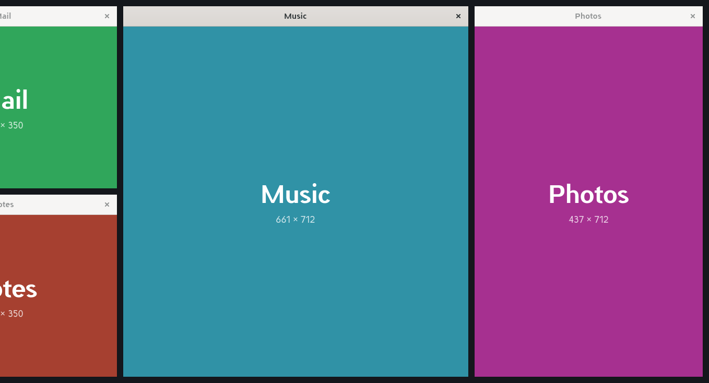

# Scrolling layout for Ada

Windows sit in columns on one horizontal strip that is wider than the screen. Each column fills the
screen's height and keeps the width you give it; windows in one column share its height. When the
columns fit, they sit in the middle of the screen. When they don't, the strip scrolls sideways to
show the window you're on. It's the layout of [Karousel](https://github.com/peterfajdiga/karousel)
(for KDE Plasma), [niri](https://github.com/YaLTeR/niri) and
[PaperWM](https://github.com/paperwm/PaperWM), made for Ada.



There are two parts:

- **`scroll/`**: the layout itself (crate `scroll-layout`). It's one file of plain Rust with no
  dependencies, and it only does the arithmetic: which window goes where, given the screen and
  what the person asked for. A compositor feeds it windows and actions and reads back rectangles.
  This is the part meant for Ada's compositor; see
  [`~/Design/ada-notes/scrolling-tiling.md`](../ada-notes/scrolling-tiling.md).
- **`scrollvil/`**: a small Wayland compositor built on Smithay 0.7, the same version Ada's
  compositor uses, that runs as a window on the desktop and tiles the apps opened inside it with
  that layout. It's how you can use the layout today, and it shows the layout working with real
  apps.

## Running Scrollvil

```sh
./install.sh
```

That builds Scrollvil and installs it in `~/.local/bin` with a **Scrollvil** entry in the app
launcher. `./install.sh --remove` takes it away again. To run it from the checkout instead:

```sh
cargo run --release -p scrollvil
```

Scrollvil opens as one window. Apps you open from inside it go into its strip: its app picker
comes up when it starts, and **Super+Return** brings it back. Apps opened from Ada's own launcher
open on Ada's desktop as usual. Maximise the Scrollvil window, or make it full screen, to give the
strip the whole screen.

If Ada keeps some Super shortcuts for itself, start Scrollvil with Alt as the shortcut key instead:
right-click its launcher entry and choose **Open with Alt shortcuts**, or run `scrollvil --mod alt`
(or `--mod ctrl-alt`).

### Shortcuts

| Keys | What they do |
| --- | --- |
| Super+Left / Right | Focus the column on the left / right (the strip scrolls to show it) |
| Super+Up / Down | Focus the window above / below in the column |
| Super+Home / End | Focus the first / last column |
| Super+1 … 9 | Focus that column |
| Super+Shift+Left / Right | Move the window into the column beside it, or out into a column of its own |
| Super+Shift+Up / Down | Move the window up / down in its column |
| Super+Ctrl+Left / Right | Move the whole column left / right |
| Super+Ctrl+Home / End | Move the column to the start / end |
| Super+R, Super+Shift+R | Next / previous width: a third, a half, two thirds of the screen |
| Super+F | The screen's full width, and back |
| Super+Minus / Equals | Narrower / wider |
| Super+E | The columns on screen share it equally |
| Super+X | Stack the column: only its focused window shows, at full height |
| Super+C | Centre the focused column |
| Super+Page Up / Page Down | Scroll the strip without changing focus |
| Super+scroll wheel or two-finger swipe | Scroll the strip |
| Super+right-drag | Change the column's width |
| Super+left-drag | Float the window and move it |
| Super+T | Float the window, or tile it again |
| Super+Return | Open an app |
| Super+Q | Close the window |
| Super+Shift+Escape, Ctrl+Alt+Backspace | Quit Scrollvil |

With the mouse: clicking a window at the edge of the screen scrolls it into view. Super and a
drag with the right button changes the window's column's width; Super and a drag with the left
button, or dragging a window by its title, takes it off the strip as a floating window. Dialogs
and fixed-size windows float by themselves.

### Commands

Everything the shortcuts do, and a little more, is also a command:

```sh
scrollvil msg focus-right
scrollvil msg next-width
scrollvil msg spawn firefox
scrollvil msg layout                 # where each window is, its size, and the strip's scroll
scrollvil msg screenshot ~/strip.png
scrollvil msg help                   # the full list
```

`scrollvil msg` finds the running Scrollvil by itself; `SCROLLVIL_SOCKET` points it at a
particular one.

### What Scrollvil doesn't do

Scrollvil is a working demonstration, not a full desktop:

- It runs nested, in one window, on one screen, with one strip (no workspaces).
- X11 apps can't open inside it (no XWayland).
- The clipboard inside it is separate from Ada's.
- It uses the default keyboard layout (US) rather than yours.
- An app that is already running on Ada's desktop and opens new windows through its existing
  instance (Files, for example) may open them on Ada's desktop instead of in Scrollvil.

These are limits of the nested demo. The layout itself has none of them.

## The layout's behaviour

- A new window opens in a new column right of the focused one, at half the screen's width, and
  gets the focus.
- Focus moves column by column; the strip scrolls only as far as it takes to show the whole
  focused column (`Scroll::Edge`), or keeps the focused column in the middle (`Scroll::Center`).
- When a focused window closes, the next window in its column takes the focus, else the column
  that moves into its place, else the one on its left.
- Preset widths are shares of the screen chosen so that columns whose shares add up to 1 fill it
  exactly, gaps included.
- A column is never narrower than its windows' minimum width, nor wider than the screen.
- When the screen or the space for windows changes size, every column keeps its share.

## Development

```sh
cargo test                  # the layout's tests, and Scrollvil's shortcuts
cargo build -p scrollvil -j 2
tools/testwin.py NAME       # a plain coloured window to try the layout with
```

Building Smithay uses a lot of memory; two jobs (`-j 2`) keep it within reach of a laptop.
Scrollvil's `build.rs` links `libxkbcommon.so.0` directly when the `-dev` package isn't
installed.

Scrollvil started from [Smithay](https://github.com/Smithay/smithay)'s `smallvil` example (MIT).
The layout was written from scratch: its behaviour follows Karousel and niri, and no code was taken
from either (both are GPL-3.0).

## Licence

MIT.
